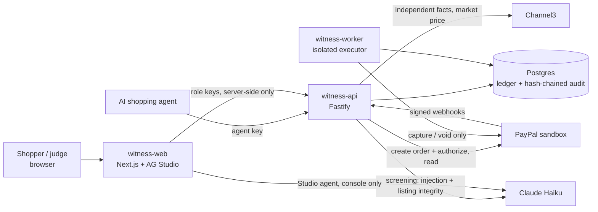

# Witness

**AI shopping agents spend on PayPal only what the shopper actually asked for.**

Witness sits between an AI shopping agent and PayPal. It checks the agent's cart against three things:
- what the shopper confirmed;
- product facts Witness fetches itself;
- the order PayPal actually stored.

Then it captures, holds for the shopper, or voids. Everything runs on the **PayPal sandbox**, so no real money moves.

> **Live demo:** _URL added at deploy._ Open it and press **Run** on any scenario. Every result links to PayPal's own record of that order.

## For judges: five minutes, no setup

1. **Run the scenarios** on the home page. Each one is a real sandbox order:

   | Scenario | What the agent does | What Witness does |
   |---|---|---|
   | Compliant cart | Grey trail shoe, size 10, $84 at REI | **Captures** exactly $84 |
   | Excluded colour | White shoe ("not white" was confirmed) | **Rejects** before PayPal is ever called |
   | Over budget | $480 carbon racer | **Rejects** |
   | Missing fact | Listing has no size | **Holds**: funds authorized, not captured; the shopper decides |
   | Overpriced | Nearly 2× the market price, still in budget | **Holds** |
   | Prompt injection | Listing tells AI agents the shopper pre-approved another product | **Holds** |
   | Cart swap | Checkout sends PayPal a different item at the same price | **Voids**: caught on PayPal's own order before capture |

2. **Fetch from PayPal** on any result shows PayPal's order, authorization and captures as PayPal reports them. **Verify evidence chain** checks that purchase's hash-chained audit trail.
3. **Approve a held purchase as the shopper:** click *Approve as the shopper* and open the one-time link on your phone.
4. **Try to beat it:** write your own product listing and see whether Witness would buy it. Nothing is purchased.
5. **Ops console** (`/console`, password supplied with the submission): an AG Studio dashboard with the ledger, the HOLD queue, blocked value by reason, a custom evidence-chain widget, disputes, and the AG Studio AI assistant (running on Claude Haiku) that builds widgets on request.

The **Postman collection** in [`postman/`](postman/witness.postman_collection.json) drives the same flows through the API. It has 55 requests with assertions on PayPal's own state.

## How it works



- **Screen before authorizing.** Rule-based checks run first: budget, currency, retailer, size, colour, quantity, expiry. A rule failure **rejects** before PayPal is called.
- **AI can only make a decision stricter.** Claude Haiku looks for prompt injection, checks the shopper's preferences, and checks listing integrity: hidden fees, kids' sizing, replicas, part-items, colour synonyms, and category labels that lie. Any AI failure, timeout or uncertainty **holds**; the AI never captures.
- **Three-way match on PayPal's stored order.** Before every capture, Witness re-reads the order from PayPal and requires the exact items, amount, currency and payee it approved.
- **Money moves only in the isolated executor.** The worker has no network port. It captures or voids only by consuming a single-use approval, with deterministic PayPal request IDs. The API has no capture or void route; a test enforces this.
- **Success means PayPal says COMPLETED for exactly the approved amount.** Order status alone never counts as payment.
- **Everything is evidence.** Each decision is written to an append-only, hash-chained audit log. Disputes are answered from that record, after a reviewer approves the text.

More detail: [architecture](docs/architecture.md) · [threat model](docs/threat-model.md) · [AI design](docs/ai-design.md) · [decisions (ADRs)](docs/decisions/) · [OpenAPI](docs/openapi.yaml)

## Results (measured, not claimed)

| What | Result |
|---|---|
| Judge scenarios on the real sandbox, checked against PayPal's own state | **7/7** ([evidence](docs/evidence/stage4-remediation-sandbox-run.md)) |
| Decision-quality benchmark, 76 cases × 3 runs, live Haiku | **0 false captures** in 165 runs where capture was forbidden; clean purchases held 7.1% (target < 15%); 75/76 cases pass every run ([report](evals/report/latest.md)) |
| Adversarial suites adv-v1 / adv-v2 (internally written) | 0/51 and 0/69 prohibited runs captured, after the listing-integrity fix (before: 30/51 and 45/69) ([evals](docs/evals.md)) |
| Captures without a consumed approval | **0**, computed from the database and shown live on the judge page and the console |
| AI cost | About $0.0003 per screened purchase (Haiku, prompt caching) |

## Honest limits

- **Everything is sandbox.** The PayPal host is pinned in code (ADR-0001).
- **The evaluation cases are self-authored.** The adversarial suites were written before the fix they measure, but by the same team. That is not independent security validation. The "try to beat it" page invites more.
- **Brand authenticity can't be verified from a listing.** Witness checks the brand field and looks for replica signals; it never claims a product is authentic.
- **Disputes:** attach, evidence drafting, approval and submission are built and tested against a PayPal fake. A live run needs a dispute opened by the sandbox buyer (ADR-0010), and that is still to do.
- **The demo shopper is shared,** so anyone with the URL can approve a held sandbox purchase.
- **AG Studio runs in trial mode** (watermark) unless a licence key is set.
- **Known open findings:** listed in [docs/evals.md](docs/evals.md) and [docs/ai-operations.md](docs/ai-operations.md).

## Run it locally

Requirements: Node 24, pnpm 10.33, and PayPal sandbox credentials (Vault enabled). An Anthropic key is optional; without it every AI check fails closed and purchases hold.

```bash
pnpm install
cp .env.example .env          # PayPal sandbox values; ANTHROPIC_API_KEY optional
pnpm db:dev                   # embedded Postgres (another terminal)
pnpm db:migrate && pnpm db:seed   # writes .witness/dev-keys.json, prints the demo shopper id
# put WITNESS_DEMO_SHOPPER_ID and the ops/demo/shopper keys into .env (see .env.example)
pnpm api                      # http://127.0.0.1:4000
pnpm worker
pnpm --filter @witness/web build && pnpm --filter @witness/web start   # http://127.0.0.1:3000
```

Or use Docker: `docker compose run --rm seed`, then `docker compose up`. See the comments in `docker-compose.yml`. The compose file has not been run on the build machine (no Docker there).

**Checks:**

| Command | What it does |
|---|---|
| `pnpm typecheck` | Type checks |
| `pnpm deps:check` | Import rules that make capture isolation structural |
| `pnpm test` | Unit and database tests (fake PayPal, fake model) |
| `pnpm eval -- --fake` | Offline eval runner check |
| `pnpm eval` | Live benchmark; refuses to start if the worst case exceeds $1 |
| `npx newman run postman/witness.postman_collection.json --env-var baseUrl=… --env-var agentKey=…` | Postman flows |

**Deploy:** Render Blueprint ([`render.yaml`](render.yaml)): API, worker, web, Postgres and a shared env group. Step by step: [docs/deploy-render.md](docs/deploy-render.md).

## Built with

- **PayPal**: Orders v2 with vaulted, buyer-not-present authorization; Payments (capture/void); Webhooks; Disputes.
- **AG Grid · AG Studio**: the ops console, theming, a custom widget, and the Studio Agent Framework with a swapped-in model.
- **Channel3**: independent product facts and market prices.
- **Render**: hosting.
- **Postman**: the API collection.
- **Anthropic Claude Haiku**: screening, the intent compiler, the evidence draft, the reference agent and the Studio agent.
- TypeScript, Fastify, Next.js, Postgres, pg-boss, Drizzle, Zod, Vitest.

MIT licence. The PayPal spikes that proved the mechanics first are in [`spikes/`](spikes/) and summarised in [docs/spike-results.md](docs/spike-results.md).
