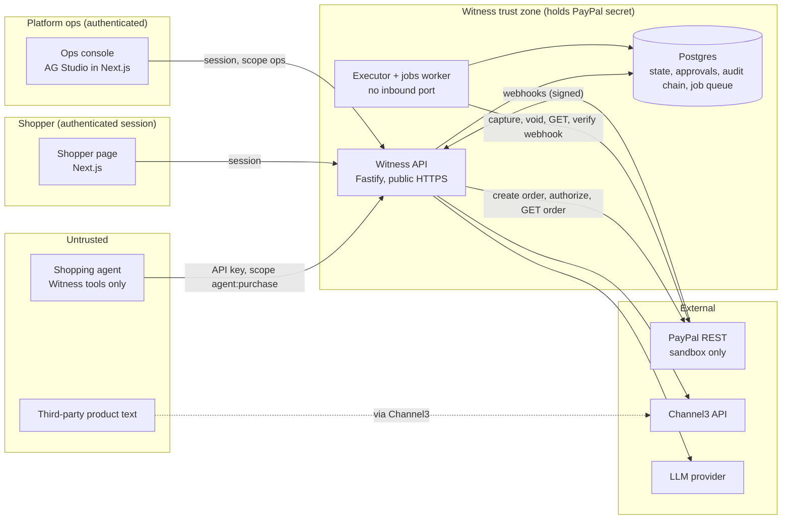
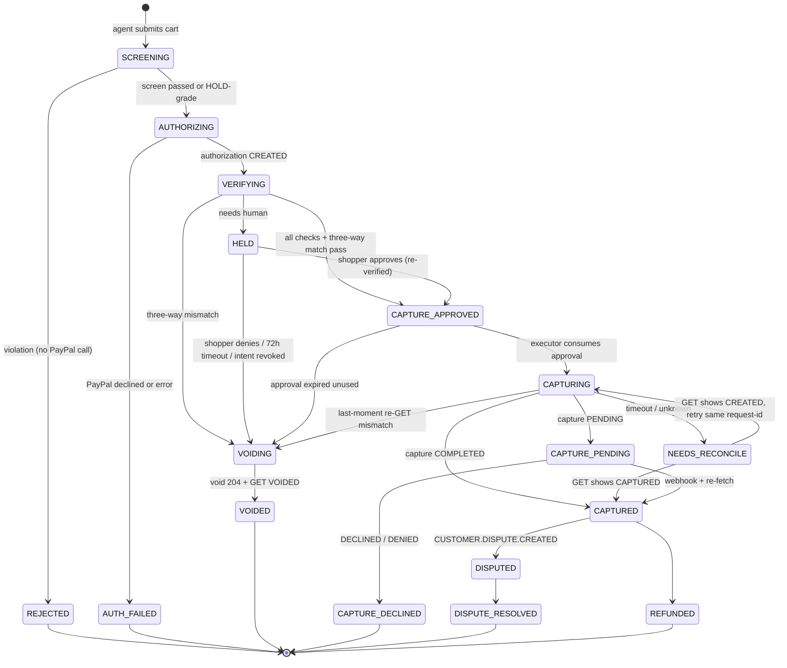
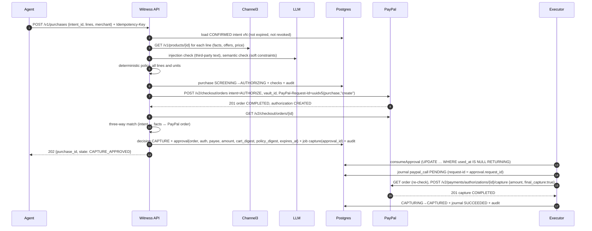
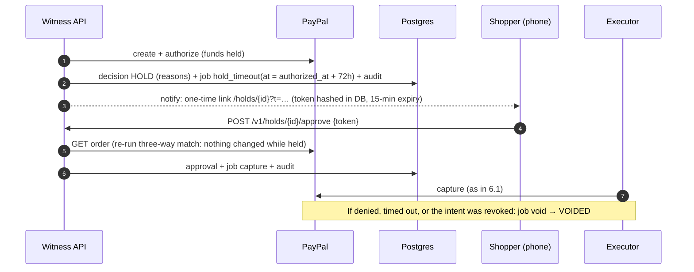
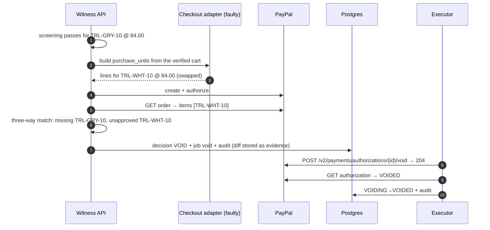

# Witness architecture

Status: **Draft for Checkpoint 2** · 2026-10-11 · Decisions referenced as ADR-NNNN live in `docs/decisions/`.

## 1. Shape of the system in one paragraph

Witness runs **inside a merchant-of-record (MoR) agent platform**: the platform charges the shopper's PayPal and then buys from a retailer. A shopper confirms an **intent**. An agent submits a **cart** against that intent. Witness re-fetches the product **facts** itself and screens the cart. If the cart is acceptable, Witness creates the PayPal order **from its own verified cart**, authorizes it against the shopper's saved wallet (Gate 2), re-reads the order from PayPal, and decides CAPTURE, HOLD or VOID. Money only moves in an isolated **executor** that has no inbound network port, and only by consuming a single-use **approval** row bound to that exact order, authorization, payee, amount and cart. Every transition is written to a hash-chained audit log in the same database transaction.

## 2. Components and trust boundaries



| Zone | Holds | Can do | Cannot do |
|---|---|---|---|
| Agent | A Witness API key with scope `agent:purchase` | Submit a cart against a confirmed intent; read its purchase status | Read or edit intents or policies, approve HOLDs, see PayPal IDs beyond status, call PayPal (has no credentials) |
| Shopper page | Shopper session; one-time HOLD tokens | Write and confirm intents, revoke them, approve or deny HOLDs | Change a confirmed intent (a change creates a new version) |
| Ops console | Ops session | Read the ledger, evidence and stats; ask the Studio agent | Approve on the shopper's behalf, capture or void directly |
| Witness API | PayPal secret, LLM key, Channel3 key | Screen carts, create and authorize orders, write decisions and approvals, receive webhooks | **Capture or void.** The executor code isn't part of this service's build (enforced in CI, §9). |
| Executor worker | PayPal secret | Consume approvals; capture, void, reconcile; process webhook events; HOLD timeouts | Accept work from anywhere except DB-backed jobs. It has no HTTP server. |

**The core invariant, enforced in four places, not by convention:**
> No code path captures unless Witness approved the exact cart, amount, payee and order that PayPal authorized, and each approval can be used once.

1. **Process:** capture and void exist only in `packages/executor`, which is bundled only into the worker. The worker exposes no port. A CI dependency rule fails the build if `apps/api` or `apps/web` imports it.
2. **Type:** `capture()` takes a `ConsumedApproval`. The only way to get one is `consumeApproval()` (a branded type the module doesn't export a constructor for).
3. **Data:** `consumeApproval()` is a single `UPDATE approvals SET used_at = now() WHERE id = $1 AND used_at IS NULL AND expires_at > now() RETURNING *`. Approvals are read from the DB by ID; the executor never accepts approval content from a caller. Agents have no write path to `approvals`.
4. **Ground truth:** right before capture, the executor re-`GET`s the order and repeats the three-way match against the approval (closes the gap between checking and using). Capture sends an explicit amount, `final_capture: true`, and a deterministic `PayPal-Request-Id`.

Honest limit: whoever holds the PayPal secret (the platform operator) can still call PayPal directly. Witness protects against the **agent**, a compromised checkout adapter, and its own bugs, not against the operator.

## 3. Who creates the PayPal order (ADR-0004)

Witness creates the order from the **cart it verified**, through a pluggable **checkout adapter** that turns approved lines into PayPal `purchase_units` (in real life, the merchant's order system). The three-way match then compares the approval with **PayPal's stored order**, not with what we meant to send. That catches:
- a faulty or compromised adapter (the demo's cart-swap scenario injects one),
- any later `PATCH` by another holder of the credentials,
- extra purchase units, a changed payee, or currency or amount drift.

## 4. Decisions and the PayPal actions they cause

| Outcome | Phase | When | PayPal effect |
|---|---|---|---|
| **REJECT** (shown as "Blocked, never sent to PayPal") | Pre-authorization | A deterministic violation (amount, currency, merchant, SKU or substitution rule, quantity, expiry) or an AI-confirmed violation with high confidence | **None.** No order, no hold, $0 (ADR-0003) |
| **HOLD** | Pre- or post-authorization | Missing fact, ambiguity, low AI confidence, price far above market, injection suspected without a hard violation | Order authorized (funds genuinely held). Shopper asked. Auto-void at 72h, inside the 3-day honour period. |
| **CAPTURE** | Post-authorization | Every check passes and PayPal's order exactly matches the approval | Capture the explicit approved amount, `final_capture: true` |
| **VOID** | Post-authorization | Three-way mismatch, or the shopper denies a HOLD, or the HOLD times out | Void the authorization; $0 captured |

REJECT is new compared with the brief. It's what makes "$0 moved, no hold" literally true for policy violations, and it follows from the Gate 2 evidence: with a saved wallet, PayPal authorizes in the same call that creates the order.

## 5. Purchase state machine



Rules:
- Transitions live in one table in code (`transitions.ts`). Anything not in the table throws `IllegalTransition`, which is a Stage 3 acceptance test.
- Every transition is one DB transaction: purchase row update (optimistic `version` check) + audit row + any outbox jobs.
- Webhooks never set state directly. They trigger a re-fetch, and the fetched PayPal state chooses the transition (§8).
- The **order** status is never used to infer whether money moved. After `/authorize` the order already reads `COMPLETED` (Stage 1 evidence). Only authorization and capture statuses count.

## 6. Sequences

### 6.1 Normal purchase (CAPTURE)



### 6.2 HOLD with a real authorization



### 6.3 Cart swap



### 6.4 Webhook processing

```mermaid
sequenceDiagram
  autonumber
  participant PP as PayPal
  participant API as Witness API
  participant DB as Postgres
  participant X as Worker
  PP->>API: POST /v1/webhooks/paypal (headers: transmission id, time, sig, cert url, auth algo)
  API->>PP: POST /v1/notifications/verify-webhook-signature {…, webhook_id, webhook_event}
  alt verification_status = SUCCESS
    API->>DB: INSERT webhook_events (id = event.id) ON CONFLICT DO NOTHING
    API->>DB: enqueue process_webhook(event.id) singleton
    API-->>PP: 200
  else failure
    API->>DB: store as rejected (for forensics)
    API-->>PP: 400
  end
  X->>DB: load event; find purchase by resource id
  X->>PP: GET the resource (authorization / capture / dispute)
  X->>DB: apply transition chosen by the FETCHED state (no-op if already there) + audit
```

Duplicates: the unique event ID drops them. Out-of-order events: harmless, because state comes from the re-fetch, and transitions that move "backwards" are no-ops. Missed webhooks: a reconciler job every 5 minutes re-fetches every purchase in `AUTHORIZING`, `CAPTURING`, `NEEDS_RECONCILE`, `CAPTURE_PENDING`, `HELD` and `DISPUTED`.

### 6.5 Dispute (ADR-0010)

```mermaid
sequenceDiagram
  autonumber
  participant B as Sandbox buyer (UI)
  participant PP as PayPal
  participant API as Witness API
  participant X as Worker
  participant M as Ops reviewer
  B->>PP: open dispute in sandbox UI (API create is not a documented operation)
  PP->>API: CUSTOMER.DISPUTE.CREATED
  X->>PP: GET /v1/customer/disputes/{id}; link to purchase via transaction id
  X->>X: build evidence package from the audit chain (template + AI-drafted narrative)
  M->>API: review and approve evidence in the console
  X->>PP: POST provide-evidence (multipart)
  Note over X,PP: Sandbox only: require-evidence / adjudicate to finish, labelled "simulated verdict"
```

## 7. Data model (Postgres, via Drizzle migrations)

| Table | Key columns | Notes |
|---|---|---|
| `tenants` | id, name, `paypal_merchant_id` (expected payee), `allowed_retailers[]` | One for the demo; the model exists so cross-merchant checks are real (closes T10). |
| `api_keys` | id, tenant_id, principal (`agent:…`/`ops:…`/`admin`), scopes[], `key_hash` (argon2id), revoked_at | Keys shown once at creation. |
| `shoppers` | id, tenant_id, display_name, `vault_id`, `vault_customer_id` | Vault ID from Gate 2's flow. |
| `intents` | id, tenant_id, shopper_id, `version`, status `DRAFT/CONFIRMED/REVOKED/EXPIRED`, source_text, `policy` jsonb (Zod `PolicyV1`), `policy_digest` (SHA-256 of RFC 8785 JCS), ambiguities jsonb, compiler {model, prompt_version}, confirmed_at, expires_at, max_purchases | Immutable after CONFIRMED. A change means a new version. |
| `purchases` | id, tenant_id, intent_id, intent_version, agent_principal, `state`, `version` (optimistic lock), cart jsonb, `cart_digest`, facts jsonb snapshot, retailer, paypal_order_id, paypal_authorization_id, paypal_capture_id, amount_cents, currency, trace_id | Unique (tenant_id, agent_principal, idempotency_key). |
| `checks` | id, purchase_id, phase `SCREEN/VERIFY/RECHECK`, check_id, kind `deterministic/ai`, result `pass/fail/unknown`, detail, evidence jsonb, model, prompt_version, latency_ms | One row per check per line. |
| `decisions` | id, purchase_id, outcome, reasons[], decided_by (`engine` / `shopper:<id>` / `timeout`) | |
| `approvals` | id, purchase_id (unique), tenant_id, paypal_order_id, paypal_authorization_id, payee_merchant_id, amount_cents, currency, cart_digest, policy_digest, intent_version, `request_id` (uuidv5(id,"capture")), expires_at, **used_at** | The single-use capability. |
| `paypal_calls` | id, purchase_id, op, request_id, status `PENDING/SUCCEEDED/FAILED/UNKNOWN`, request jsonb (redacted), response jsonb, http_status, debug_id, timestamps | Written **before** each money call and reconciled after (closes "record after capture"). |
| `webhook_events` | event_id (PK), event_type, resource_type, resource_id, transmission_id, verified, payload jsonb, received_at, processed_at, outcome | |
| `holds` | purchase_id, token_hash, token_expires_at, notified_at, resolved_at, resolution | |
| `disputes` | id, paypal_dispute_id, purchase_id, status, evidence jsonb, steps jsonb | |
| `audit_log` | `seq` bigserial, epoch, tenant_id, purchase_id, event_type, payload jsonb, `prev_hash`, `hash` | `hash = SHA-256(prev_hash ‖ JCS({seq, epoch, event_type, purchase_id, payload, at}))`. A trigger rejects UPDATE and DELETE; the app role has INSERT and SELECT only. |
| `pgboss.*` | job queue (ADR-0006) | Same database, so jobs are enqueued in the same transaction as the state change. |

**Demo reset without breaking the chain:** reset voids every open authorization (a real PayPal call per authorization), then starts a new audit **epoch** and a fresh demo tenant. Old rows stay, and the chain stays verifiable.

## 8. Idempotency and failure handling

| Edge | Mechanism |
|---|---|
| Agent → `POST /v1/purchases` | `Idempotency-Key` required. Stored with a request hash: the same key and body returns the original response; the same key with a different body returns 422. |
| API → PayPal create order | `PayPal-Request-Id = uuidv5(purchase_id, "create-order")` |
| Executor → capture | `PayPal-Request-Id = approval.request_id`. PayPal documents that a repeat with the same ID returns the existing capture (**Verified**: Payments v2 schema example "idempotent capture request"). How long PayPal keeps the key is **Unknown**, so retries happen within minutes. |
| Executor → void | `uuidv5(purchase_id, "void")` |
| Jobs | pg-boss with a singleton key per `(purchase_id, op)`. Handlers are idempotent: they read the state first and do nothing if it already moved. |
| Webhooks | `event_id` primary key + re-fetch (§6.4) |
| **PayPal succeeded but Witness failed to record** | The `paypal_calls` row was PENDING before the call. The reconciler finds it, re-`GET`s the authorization, sees `CAPTURED` with the capture ID, and completes the transition. No money is lost or repeated. |
| Timeout during capture | → `NEEDS_RECONCILE` → GET authorization → if still `CREATED`, retry with the **same** request ID; if `CAPTURED`, record it. |
| Authorization nearing expiry | HOLD auto-voids at 72h. A `CAPTURE_APPROVED` purchase not executed within 10 minutes gets its approval expired and is voided. |

## 9. Code layout (monorepo, pnpm workspaces)

```
apps/
  api/        Fastify: public HTTP, screening, order creation, webhooks receiver   (no executor import)
  worker/     pg-boss consumers: executor, webhook processing, reconciler, HOLD timeouts, disputes
  web/        Next.js: shopper page, judge landing page, ops console (AG Studio), dispute view
  agent/      reference shopping agent: Witness tools + Channel3 search only
packages/
  core/       policy schema, deterministic checks, cart digest, three-way match, state machine (pure, no I/O)
  executor/   capture/void/consumeApproval: imported by apps/worker ONLY (dependency-cruiser rule in CI)
  paypal/     typed PayPal REST client (sandbox host guard, request-id, redaction, journal hooks)
  db/         Drizzle schema, migrations, audit-chain writer, repositories
  ai/         LLM interface, prompts (versioned files), Zod output schemas, fail-closed wrappers
  catalog/    Channel3 normaliser + fixture catalog fallback
evals/        decision-quality cases (JSONL), runner, published report
spikes/       Phase 1 evidence (kept as-is)
```

`packages/core` is pure TypeScript with no network or database access, which is where most tests run. The current `spikes/lib/gate.mjs` logic ports into it, and every `validation/REPORT.md` failure becomes a test (§11).

## 10. API surface (summary; full spec in `docs/openapi.yaml`)

Public base: `https://<api-host>/v1`. All bodies are Zod-validated; unknown fields are rejected.

| Method & path | Principal | Purpose |
|---|---|---|
| `POST /intents` | shopper | Compile free text → DRAFT policy + ambiguities |
| `POST /intents/{id}/confirm` | shopper | Freeze → CONFIRMED vN, returns `policy_digest` |
| `POST /intents/{id}/revoke` | shopper | Revoke. Open HOLDs on it are voided. |
| `GET /intents/{id}` | shopper, ops | Read |
| `POST /purchases` | agent | Submit a cart for an intent (`Idempotency-Key`) |
| `GET /purchases/{id}` | agent (status only), shopper, ops | State, decision, reasons |
| `GET /purchases/{id}/evidence` | shopper, ops | Checks, facts, PayPal IDs, chain proof |
| `POST /holds/{purchase_id}/approve` · `/deny` | shopper + one-time token | Resolve a HOLD |
| `POST /webhooks/paypal` | PayPal (signature-verified) | Webhook intake |
| `GET /verify/purchases/{id}` · `GET /verify/chain` | public | Recompute the hash chain |
| `GET /console/purchases` · `/holds` · `/stats` | ops | Ledger data for AG Studio |
| `POST /demo/scenarios/{name}` · `POST /demo/reset` | admin (judge page uses a rate-limited demo key) | Run a named scenario; void all open authorizations and start a new epoch |

**There is no capture or void endpoint anywhere.**

## 11. How each `validation/REPORT.md` finding is closed

| Finding | Closed by |
|---|---|
| T3 merchant ignored | `PolicyV1.retailers` is checked against the Channel3 offer domain, and the PayPal payee against `tenants.paypal_merchant_id`. Unknown policy fields are rejected by Zod `.strict()`. |
| T4a no SKU / substitution rule | `PolicyV1.products` (allowed canonical IDs) plus `substitution: "deny" / "hold" / "same_category_under_max"` |
| T6 payee change undetected | The three-way match compares `purchase_units[].payee.merchant_id` with the approval |
| T7 replay | Approval bound to order and authorization IDs; `used_at` consumed atomically; `max_purchases` on the intent |
| T9a forged approval | Approvals exist only as DB rows written by the decision engine; the executor reads by ID |
| T9b direct capture | Executor package in the worker only, no port, branded `ConsumedApproval`, CI import rule |
| T10 cross-merchant | Tenant scoping on every query; API keys bound to a tenant; payee check |
| X1 negative quantity | Zod: quantity is an integer from 1 to 99; prices are non-negative integer cents |
| X3 stale policy / no expiry | Approval stores `policy_digest` and `intent_version`, and must equal the current CONFIRMED version; `expires_at` |
| X4 extra purchase units | The match iterates **all** purchase units; more than one unit is rejected (Witness creates exactly one) |
| Random retry keys | Deterministic `PayPal-Request-Id` (§8) |
| Record written after capture | `paypal_calls` journal PENDING before the call, plus the reconciler |
| No webhooks | §6.4 |
| "Signed" wording | Fixed in Stage 1. Evidence says "recorded, hash-chained". Real signatures (shopper passkey over the policy digest) are on the cut list. |

## 12. Observability

- pino JSON logs. `trace_id = purchase_id`, propagated into job payloads and logged with every PayPal `debug_id`. Bearer tokens and secrets are redacted by a logger serializer, with a unit test.
- `/healthz` (process) and `/readyz` (DB + PayPal token) on the API. The worker writes a heartbeat row, and the console shows it.
- The console shows each purchase's timeline with **live "fetch from PayPal" links** that call `GET /v1/purchases/{id}/paypal` (the API proxies a read-only GET), so a judge sees PayPal's own status.
