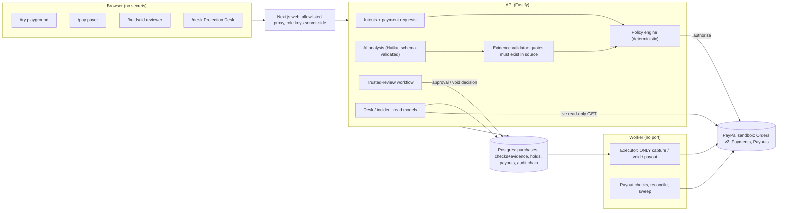
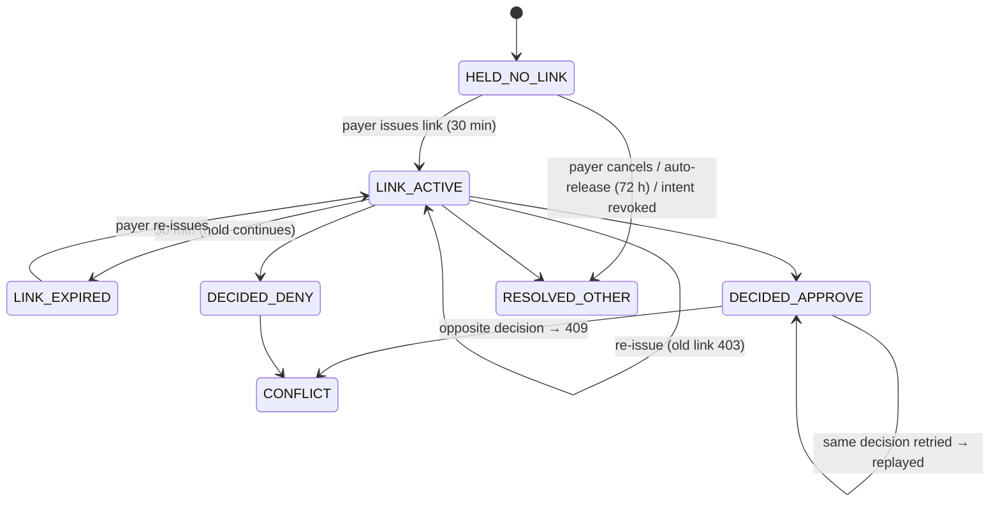

# Second Key: product plan (assessment, PRD, system design, UX, AG Grid, KPIs, risks, backlog, demo, readiness)

Written 2026-10-17. It is based on an audit of branch `secondkey-feasibility-sprint` @ `05784fa` (identical to `origin/main`, which Render deploys) and of the live site `https://witness-web.onrender.com`. Each claim is marked **[verified]** (code, test or live run), **[live]** (checked on the deployed site) or **[proposed]**.

---

## D1. Executive assessment

### Baseline audit

| Category | Findings |
|---|---|
| **Demonstrably works** | Transfer and shopping intents with deterministic screening (ADR-0016) [verified: 435 tests]. Quote-grounded manipulation and injection checks; AI can only add `unknown`/HOLD [verified]. PayPal Orders v2 AUTHORIZE with a vaulted sandbox buyer; executor-only void/capture/payout; idempotent request IDs; three-way match [verified live: acceptance 30/30]. Reviewer link: 30-min lifetime, one decision, idempotent replays, 409 on conflict [verified: 11 DB tests]. Payout after a verified capture, item SUCCESS read from PayPal [verified live locally]. Hash-chained audit log. Payer, reviewer, Desk and agent screens on the real API [live: scam → HOLD, PayPal "reserved" on Render]. |
| **Works only locally or in the sandbox** | Everything money-related is PayPal **sandbox**. Payouts are off on Render (`SECONDKEY_DEMO_RECIPIENT_EMAIL` unset) [live]. The audio pipeline (System.Speech, Chrome on-device) is local only. |
| **Simulated or static** | People and conversations are synthetic. The scam call is a prepared four-line script. Link delivery is shown on screen instead of by SMS. The "trusted contact" is whoever opens the link. |
| **Incomplete or unverified** | No public way to test the AI on your own text [live: `/try` 404]. Detection metrics come only from a self-written set (76 cases). No screenshot upload in the product (proven only in a spike). The payer can't cancel a hold from `/pay`. No reviewer identity or invitation. |
| **Misleading, confusing, weak** | (1) **The core assumption** that Second Key sees the conversation behind a payment, which a scammer prevents. (2) A canned, obvious scam script; "100%" on own data reads as staged. (3) The Desk is password-gated, so judges see a login wall [live]. (4) The reviewer says "Demo Shopper" on Render. (5) Both scenarios are $1,800. (6) The agent demo shows "injection detected" more than an intent-vs-cart comparison. (7) The Desk grid is a plain list; the AI vs. policy vs. human vs. PayPal separation isn't visible in the grid. |
| **Preserve** | Engine, executor, payout, holds, audit, PayPal clients, evidence grounding, state wording (`lib/sk.ts`), design tokens, reviewer flow, tests, acceptance and rehearsal scripts. |
| **Rebuild** | The evidence acquisition story (signals first, evidence optional); the Desk grid; the landing narrative; the agent scenario presentation. |
| **Out of scope** | Real P2P interception; listening to calls; partner/multiparty onboarding; production identity (KYC for reviewers); SMS delivery; multi-currency beyond USD in the sandbox demo. |

### Thesis

**Second Key is an evidence-backed intervention layer for consequential payments in workflows it is integrated into.** Detection is uncertain, so execution must be controlled. Second Key turns a risky moment into a short, explicit, auditable decision. Every money outcome is read back from PayPal.

### Strongest differentiator

**The proof chain:** evidence quote → deterministic policy → named human decision → executor-only PayPal action → PayPal's own record → hash-chained audit. Competing "AI scam detectors" stop at a warning. Second Key ends at a verified money state.

### Biggest credibility gap

**Evidence acquisition.** Fix: the **trigger comes from transaction signals the integrating platform has**, plus a **rule the payer set in advance** (consent). Conversation evidence becomes **optional** and voluntary. The product must be useful when none is shared.

### Main judge objections and the answer

| Objection | Answer |
|---|---|
| "How do you see the call?" | We don't. Signals plus a pre-agreed rule trigger the pause. Sharing a message or screenshot is optional and voluntary. |
| "Your detector is tuned to your own script." | A public `/try` playground on the real model; an evaluation on public-domain examples with misses reported. |
| "This isn't PayPal Send Money." | Correct. It's a layer a wallet, marketplace or agent platform integrates. The demo uses authorization → void/capture → payout, all real PayPal sandbox calls. |
| "Who is the reviewer? What if they're the abuser?" | The payer chooses the rule and the reviewer in advance. The reviewer can never change the payee or amount, or receive funds. The payer can always cancel. Loosening the rule doesn't affect payments already held. |
| "Real emergencies get delayed." | Holds have a visible auto-release; the payer can cancel and resend; the rule applies only above the payer's threshold. |

**Keep:** the proof chain, the honest wording, the payout. **Change:** the trigger (signals plus consent), the Desk, the agent scenario. **Remove:** the hero's reliance on the phone-call story. **Defer:** audio, SMS, identity.

---

## D2. Product requirements

**Users.**

- **Payer**: anyone sending a consequential payment; also an older adult who opted in.
- **Trusted reviewer**: chosen by the payer.
- **Operator/investigator**: at the integrating platform.
- **Agent-platform developer**: whose agent spends on a user's behalf.

**Use cases.**

1. A payer sends a first payment above their own threshold, and the pre-agreed rule pauses it.
2. The payer optionally shares the message that prompted it and sees evidence-linked findings.
3. The reviewer decides; the money outcome is verified.
4. A clean payment goes straight through and is paid out.
5. An agent's cart doesn't match the user's intent, so it is paused and reviewed.
6. An operator investigates incidents, sees unresolved and failed actions, and exports a redacted report.
7. A visitor tests the analyser on their own text.

**Functional requirements (P0/P1).**

- **FR1** Policy v2: signals (first payment, amount vs. the payer's threshold, a payee not in the intent, an agent cart mismatch) and optional AI findings → `PROCEED | REVIEW | HOLD`. Deterministic and explained per rule.
- **FR2** Evidence is optional on transfers. Without it, the decision rests on signals and rules alone, and the UI says "no conversation was shared".
- **FR3** The payer can attach evidence (paste text; screenshot in P2), see excerpts, and mark a finding "this isn't right" (recorded, does not change policy automatically).
- **FR4** Reviewer flow (exists) plus "payer cancels" from the payer screen.
- **FR5** Separate authorization, capture and payout states in every surface.
- **FR6** Public `/try`: real analysis, bounded input, rate-limited, separate spend cap, no payment.
- **FR7** Public read-only Desk for the current demo session; operator actions gated by the console session.
- **FR8** Desk grid: column groups (Assessment · Policy · Human · PayPal), saved views, summary lenses with per-currency totals, inline evidence rows, keyboard use, redacted CSV.
- **FR9** Agent scenario shows intent fields vs. retrieved listing vs. cart, and which comparison triggered the hold.

**Non-functional requirements.**

- Sandbox only.
- No secrets client-side.
- Public endpoints rate-limited and cost-capped.
- p95 analysis under 8 s.
- Accessible (keyboard, contrast, reduced motion).
- Cold start: a clear loading state.
- All money states sourced from PayPal records.

**Out of scope:** see D1.

**Acceptance:** each backlog item in D8 carries its own.

---

## D3. System design

### Architecture



### Request and event flow (held transfer, deny)

```mermaid
sequenceDiagram
  participant P as Payer UI
  participant A as API
  participant AI as Model
  participant PP as PayPal
  participant R as Reviewer UI
  participant X as Executor
  P->>A: transfer (payee, amount, optional evidence)
  A->>A: deterministic checks (intent, amount, payee, signals)
  A->>AI: evidence (untrusted), schema-validated output
  AI-->>A: findings; quotes grounded by code
  A->>PP: create order (AUTHORIZE, vault)
  PP-->>A: authorization CREATED
  A->>A: policy → HOLD; audit purchase.held
  P->>A: issue one-time link
  R->>A: deny (token)
  A->>A: row lock HELD → VOIDING; audit void_decided
  A-->>R: 200 "decision recorded"
  X->>PP: void (deterministic request id)
  PP-->>X: 200
  X->>A: VOIDED; audit purchase.voided
  R->>A: verification (token) → live GET → VOIDED, 0 captures
```

### Payment state machine (authorization, capture and payout kept separate)

```mermaid
stateDiagram-v2
  [*] --> SCREENING
  SCREENING --> REJECTED: rule fails (PayPal never called)
  SCREENING --> AUTHORIZING
  AUTHORIZING --> AUTH_FAILED
  AUTHORIZING --> VERIFYING: authorization CREATED
  VERIFYING --> HELD: policy REVIEW/HOLD
  VERIFYING --> CAPTURE_APPROVED: policy PROCEED
  VERIFYING --> VOIDING: three-way mismatch
  HELD --> VOIDING: deny / payer cancels / auto-release / intent revoked
  HELD --> CAPTURE_APPROVED: approve (after PayPal re-check)
  CAPTURE_APPROVED --> CAPTURING
  CAPTURING --> CAPTURED: capture COMPLETED, exact amount
  CAPTURING --> CAPTURE_PENDING
  CAPTURING --> NEEDS_RECONCILE: timeout / refusal / mismatch
  NEEDS_RECONCILE --> CAPTURING: retry, same request id
  VOIDING --> VOIDED
  CAPTURED --> [*]
  VOIDED --> [*]
  note right of CAPTURED: Payout has its own machine (payouts table):\nSENDING → PENDING → SUCCESS | UNCLAIMED | FAILED…\nUNKNOWN → retried with the same request id
```

### Trusted-review state machine



### Data model (core)

- `intents(id, shopper_id, policy jsonb [shopping | transfer: payee{id,name,first_payment,email?}, amount, purpose], status, policy_digest)`
- `purchases(id, intent_id, request jsonb [kind, conversation?], state, cart, amount_cents, currency, paypal_order_id, paypal_authorization_id, paypal_capture_id, reasons)`
- `checks(id, purchase_id, phase, check_id, kind[rule|ai], result, detail, evidence jsonb [tactic, quote, source, speaker, line], model, prompt_version)`
- `decisions(purchase_id, outcome, reasons, decided_by, at)`
- `holds(purchase_id, token_hash, token_expires_at, auto_void_at, resolution)`
- `approvals(purchase_id, single-use, ttl)`
- `payouts(purchase_id PK, receiver, amount, sender_batch_id UNIQUE, request_id, batch_id, item_id, status)`
- `paypal_calls(journal of every money call)`
- `audit_log(epoch, seq, hash chain)`

### API contracts (new or changed, [proposed] unless marked)

| Method and path | Who | Request | Response |
|---|---|---|---|
| `POST /v1/demo/analyze` | public (via proxy, rate-limited, demo spend cap) | `{ text ≤ 4000, context? ≤ 300 }` or `{ sample: id }` | `{ analysis: {risk, confidence, findings[{tactic, quote, speaker, line, why}], ungrounded[], legitimate_explanation, needs_verification}, policy: {outcome, rules[]}, model, prompt_version, latency_ms, source: "live"|"error" }`; no payment |
| `GET /v1/demo/samples` | public | — | labelled samples `{id, label, provenance, text}` |
| `GET /v1/demo/incidents` | public (demo key) | `?limit` | current demo session only; masked; read-only |
| `GET /v1/purchases/:id/evidence` | ops/demo (exists) | — | adds `policy` breakdown |
| `POST /v1/me/holds/:id/cancel` | payer (shopper) | — | same semantics as deny; `decided_by: shopper` |
| Existing | | `/v1/holds/:id`, `/verification`, `approve`, `deny`, `/paypal`, scenarios | [verified] |

### Security invariants

1. Only the executor process can capture, void, refund or pay out. The transport guard and architecture rules enforce it [verified].
2. Model output can only add `unknown`; no model field reaches a money call [verified].
3. Quotes shown as evidence exist in the source (code check) [verified].
4. Payout receiver = the payer-confirmed intent email only; one per purchase [verified].
5. A reviewer token is bound to one purchase, expires in 30 min and decides once [verified].
6. Money states shown come from PayPal responses or GETs, never from order status [verified].
7. Public endpoints never create payments, are input-bounded, rate-limited and spend-capped [proposed for `/try`; the pattern is verified on `/demo/screen`].
8. The public Desk shows only the current demo session, read-only; actions need the console session [proposed].

### Failure-mode analysis

See D7 (each high-severity row has a state transition and a test).

---

## D4. Website and UX specification

### Creative directions considered

| Direction | Credibility | Differentiation | Usability | Accessibility | AG Grid fit | Cost | Verdict |
|---|---|---|---|---|---|---|---|
| **1. Financial Control Room** (dense, legible ops) | High | Medium | High for operators | High | **Excellent** | Low | **Use for the Desk** |
| **2. Trust Layer** (calm consumer clarity) | High | Medium-high | High for payers | High | Low | Low (exists) | **Use for payer, reviewer, /try** |
| **3. Transaction Observatory** (visual links between evidence, decisions and money) | Medium (risks gimmick) | High | Medium | Harder | Medium | High | Borrow **one** element only: the "proof chain" rail linking quote → rule → decision → PayPal |

**Chosen system:** the existing paper/ink/evergreen/brass tokens (one identity). The Trust Layer drives the consumer surfaces; the Control Room density (14 px grid, mono references) drives the Desk. The **proof chain** is the product's visual signature everywhere: four linked steps, **Evidence → Rule → Decision → PayPal**, each marked by who produced it (AI, policy, person, PayPal).

### Information architecture (smallest complete set)

| Page | Audience | Question | Main action | Data / dependencies | Empty and failure states | Judge takeaway |
|---|---|---|---|---|---|---|
| `/` | Everyone | What is this, and is it real? | Try it / watch the proof | static plus the live legend | — | An intervention layer with verified money outcomes |
| **`/try`** (new) | Judges, skeptics | Does the AI actually work on *my* text? | Analyse | `POST /demo/analyze`, samples | Rate limit, spend cap, model down → explicit error, never a canned result | Real, evidence-linked, uncertain-aware; the AI is separate from policy |
| `/pay` | Judges | What does the payer experience? | Send, add evidence, ask a reviewer, cancel | scenarios, purchases, paypal | API cold start, PayPal down | A calm pause, verified outcomes |
| `/holds/:id` | Reviewer | Should this go ahead? | Don't send / Send | hold view, verification | Expired, replaced, conflict, 502 | Decision ≠ money result until PayPal confirms |
| `/desk` | AG Grid judge, operators | What needs attention; did the rail enforce it? | Investigate, filter, export | incidents, evidence, paypal | Empty session, stale data, errors | AG Grid essential to an operational workflow |
| `/agent` | Agentic-commerce judge | What did the agent see vs. what the user asked? | Run agent | scenarios, evidence | — | Field-level mismatch → hold |
| `/how` (new) | Technical reviewer | Architecture, limits, evaluation | Read | static plus evaluation JSON | — | The team knows the boundaries |

### Key interaction specifications

- **`/try`:**
  - Left: a textarea (or pick a labelled sample: suspicious / legitimate / hard case).
  - Right: three stacked panels:
    1. **"What the AI observed"**: quotes with tactics, highlighted in the source; ungrounded quotes listed as discarded.
    2. **"How sure it is, and what it can't know"**.
    3. **"What policy would do"**: the rule table, separate from the AI.
  - Badge: "Live analysis · model · 3.1 s". On error: "Analysis unavailable: nothing is shown instead of a fake result".
- **Desk:** grid on the left (header groups Assessment · Policy · Human · PayPal); lens strip above (group by status / workflow / risk with counts and per-currency totals, click to filter); saved views (Needs review · Action failed or unresolved · Resolved today · All); a full-width inline "evidence peek" row on expand; the detail panel on the right (exists). Cells flash when a payment state changes on refresh.
- **Mobile:** consumer pages single column (exists). The Desk on mobile becomes list plus detail, with the grid's horizontal scroll and pinned first column.

---

## D5. AG Grid implementation plan

**Licence (verified from installed `ag-grid-community@36.2.0` module exports):**

- **Community (used):** `QuickFilterModule`, `ExternalFilterModule`, `PinnedRowModule`, `GridStateModule`, `CsvExportModule`, `ColumnGroupModule`, `HighlightChangesModule`, `TooltipModule`, `RowSelectionModule`, `KeyboardNavigationModule`, `RowAutoHeightModule`, full-width rows, custom cell renderers, `PaginationModule`.
- **Enterprise (not used, not licensed):** `RowGroupingModule`, `AggregationModule`, `MasterDetailModule`, `SetFilterModule`, `StatusBarModule`, `SideBarModule`, `SparklinesModule`, `ExcelExportModule`. `ag-grid-enterprise` is present only as an AG Studio dependency.

**Community equivalents, disclosed in the UI:**

- grouping and aggregation → lens strip computed from `forEachNodeAfterFilter`, plus pinned per-currency totals;
- master/detail → full-width inline rows plus the detail panel.

**Schema (one row per incident, stable `getRowId = purchase id`):**

- *Incident:* id · detected_at (UTC stored, local shown with zone) · workflow (transfer | agent purchase) · payer label · recipient or merchant · amount_cents + currency.
- *Assessment (AI):* top pattern · evidence count · evidence source (conversation | listing | none).
- *Policy:* outcome (PROCEED | REVIEW | HOLD | REJECT) · first failing rule.
- *Human:* review status (not needed | awaiting | approved | denied | expired | auto-released) · decided_by.
- *PayPal (recorded):* authorization (created | voided | captured | none) · capture (none | completed | pending | declined) · payout (n/a | pending | success | failed | unknown).
- *Resolution:* open | resolved | needs attention.

**Renderers:** a state cell (word plus a subtle dot, never colour alone); a money cell (tabular numerals, currency code); an evidence cell (first quote, truncated, with a tooltip); a proof-chain mini rail (four segments: AI · policy · human · PayPal).

**Workflows:**

- quick filter;
- saved views (external filter plus `GridState` per viewer in `localStorage`, try/catch);
- lens click → external filter;
- expand → full-width evidence row;
- select → detail panel;
- redacted CSV (`processCellCallback`: masks emails and neutralises formula prefixes);
- operator action "Re-check with PayPal" (live GET; read-only; available publicly).

**State:** the grid's `rowData` is the single source; the detail panel fetches by id; polling uses `applyTransaction({update})` so selection and scroll survive, with highlight-on-change.

**Tests:**

- pure functions (row mapping, per-currency totals, view predicates, CSV redaction) as unit tests;
- the incidents endpoint with masking and session scope as DB tests;
- the rehearsal script opens the Desk publicly.

---

## D6. KPI and evaluation plan

| KPI | Definition | Measurement | Baseline | Target (submission) | Source | Priority | Limitations |
|---|---|---|---|---|---|---|---|
| Money states verified | Share of displayed authorization/capture/payout states backed by a PayPal response or GET | Code review + acceptance | 100% in acceptance [verified] | 100% | acceptance JSON | P0 | Sandbox only |
| Duplicate money actions under retries | Captures/voids/payouts > 1 per purchase | DB tests with injected timeouts | 0 [verified] | 0 | tests | P0 | Fake PayPal for injected faults |
| Conflicting reviewer decisions accepted | Both approve and deny applied | DB tests | 0 [verified] | 0 | tests | P0 | — |
| High-severity failure paths with tests | Covered rows in D7 / high-severity rows | Risk register | ~70% (estimate from D7) | ≥ 90% | D7 | P0 | Self-assessed |
| Recall / precision / FPR (held-out) | On a labelled set, flagged = not PROCEED | `secondkey/spikes/s1/run.ts` | Own set: recall 100% (n=46), FPR 0% (n=30) | Report on a public-domain set with CIs; target recall ≥ 85%, FPR ≤ 15% | eval JSON | P1 | Small n; not representative |
| Quote fidelity | Shown quotes that exist in source / shown quotes | Code (grounding) | 100% by construction | 100% | eval | P0 | Says nothing about relevance |
| Structured-output validity | Valid schema outputs / calls | Eval run | 100% (n=76) | ≥ 99% | eval | P1 | — |
| Analysis latency p50 / p95 | Model call time | Eval + `/try` logs | 2.4 s / 6.1 s | p95 < 8 s | eval | P1 | Provider variance |
| Cost per analysis | USD per call | meter | ~$0.0002 | < $0.002 | meter | P1 | — |
| Clean-session demo success | Rehearsal 8/8 from reset | `rehearse.ts` | 8/8 local | 8/8 on Render | report | P0 | Needs Render warm |
| Cold start | First page and first API call after idle | Manual on Render | unknown | < 60 s with a visible loading state | manual | P1 | Plan-dependent |
| Time to explain the product | A new visitor states the product correctly | 3 people, think-aloud | unknown | ≤ 30 s from the landing page | test notes | P1 | Tiny sample |
| Time to complete `/try` | Paste → findings | timer | n/a | < 15 s | manual | P1 | — |
| Time to find a held incident | Open Desk → selected held incident | timer | unknown | < 10 s | manual | P1 | — |
| Recovery-state coverage | Key workflows with explicit error/empty/expired states | checklist | payer, reviewer, Desk ✓ | + `/try`, public Desk | checklist | P1 | — |

**Evaluation set strategy:**

- Dev and held-out splits stay separate.
- Add a **public-domain** set: US government (FTC/FBI) consumer-alert example messages are public-domain works. Each item keeps its source URL.
- Benign counterexamples are written separately by someone else, or paraphrased from real-life patterns without personal data.
- Report n, 95% CIs and every miss. Disclose that the set is small and unrepresentative.

---

## D7. Risk register (abridged; full test mapping in the repository tests)

| # | Risk | Sev | Lik | Detection / mitigation | Expected transition | Test |
|---|---|---|---|---|---|---|
| R1 | Model invents a quote | H | M | Code grounding; ungrounded quotes discarded | none (not evidence) | `manipulation.test.ts` ✓ |
| R2 | Model down / timeout / malformed | H | M | `unknown` → HOLD; `/try` shows an error, not a result | SCREENING → … HELD | `secondkey.db.test` ✓ |
| R3 | Prompt injection in evidence | H | M | Content treated as data; schema output; AI can't act | HOLD at most | own set h-injection ✓ |
| R4 | Calm, professional scam (false negative) | H | M | Signals-first rule catches first-payment-over-threshold regardless of AI | VERIFYING → HELD by rule | **to add** (policy v2) |
| R5 | Benign urgent message (false positive) | M | M | Reviewer decides; payer can cancel or resend; auto-release | HELD → approve → CAPTURED | ✓ approve path |
| R6 | Authorization OK, response lost | H | L | Journal UNKNOWN → reconcile, same request ID | AUTHORIZING → reconcile | executor tests ✓ |
| R7 | Capture or payout repeated | H | M | Deterministic IDs; single-use approval; payouts PK | no second action | `payout.db.test` ✓ |
| R8 | Cart/amount/payee changed after the check | H | L | Three-way match at approve and before capture | → VOIDING | stage4 ✓ |
| R9 | Void fails | H | L | Retry, same ID; NEEDS_RECONCILE; Desk "unresolved" view | VOIDING → NEEDS_RECONCILE | executor ✓ |
| R10 | Authorization expires while held | M | L | Auto-release at 72 h < 3-day honour period | HELD → VOIDING | hold-timeout ✓ |
| R11 | Link replay / guessing | H | L | 192-bit hash, one decision, 30 min | 403/410 | holds-security ✓ |
| R12 | Concurrent reviewer decisions | H | M | Row lock; loser 409 | one wins | holds-security ✓ |
| R13 | Payer cancels while the reviewer decides | M | M | Same lock; the later one gets 409 | one wins | **to add** with payer cancel |
| R14 | Reviewer unreachable | M | M | Payer re-issues the link or cancels; auto-release | HELD → VOIDING (72 h) | ✓ |
| R15 | Reviewer is the abuser | H | L | Reviewer can't change payee or amount or receive funds; payer can always cancel; Desk records who decided | — | invariant tests ✓ (payee/amount binding) |
| R16 | Scammer coaches the user to replace the reviewer or loosen the rule | H | M | **Proposed:** loosening changes apply only to *new* payments and take effect after a delay; tightening is immediate. Justified by the coaching threat; usability cost is small (rules change rarely) | held payments unaffected | **to design** (P2) |
| R17 | Reviewer decision OK, money action fails | H | L | UI shows "decision recorded" ≠ "cancelled"; NEEDS_RECONCILE surfaced | VOIDING → NEEDS_RECONCILE | ✓ wording tests |
| R18 | Public endpoint abuse / cost | M | H | Rate limit, input bounds, separate spend cap, no payment | 429 / 503 | **to add** with `/try` |
| R19 | Public Desk leaks data | H | L | Demo tenant, current session only, masked fields, no actions | — | **to add** |
| R20 | Sensitive data in logs or exports | M | M | No conversation in logs; masked emails; CSV formula neutralisation | — | **to add** with CSV |
| R21 | Demo loses DB, model or PayPal | M | M | Clear errors; recorded video fallback labelled as a recording | — | rehearsal ✓ |
| R22 | Cross-tenant leakage | H | L | Tenant-scoped queries | — | console tests ✓ |
| R23 | Mixed currencies aggregated | M | L | Totals per currency only | — | **to add** (unit) |

---

## D8. Prioritised backlog

| # | Task | Priority | User / judge value | Effort | Risk | Depends on | Acceptance |
|---|---|---|---|---|---|---|---|
| 1 | **`/try` playground**: `POST /v1/demo/analyze` + samples + page | **P1 (start now)** | Removes "canned" doubt; Innovation, Tech, Design | M | Low | demo spend cap (exists) | Real model result with grounded quotes; AI vs. policy separated; 400/429/503 handled; no payment possible; DB/unit tests |
| 1b | **Detector: name instructions aimed at the AI as evidence** (new `instruction_to_ai` tactic in the prompt and schema). Found live on `/try`: the model resisted the injected instruction and the payment was still held (rule R2), but the instruction wasn't surfaced as a quoted finding | P1 | Credibility of the 'AI can't be steered' claim; unifies human and agent evidence | S | Low | 1 | The injection sample shows the instruction as a quoted finding; evaluation rerun |
| 2 | **Public read-only Desk** (`GET /v1/demo/incidents`, demo-role evidence) | **P1 (start now)** | AG Grid judge sees the Desk without a password | S–M | Low | 1 not required | Session-scoped, masked, no actions; tests |
| 3 | **Desk grid v2** (header groups, separate PayPal states, lens strip + per-currency totals, saved views, inline evidence rows, highlight changes, redacted CSV) | P1 | Best Use of AG Grid | M–L | Medium | 2 | D5 behaviours; unit tests for mapping, totals, views, CSV |
| 4 | **Policy v2: signals first, evidence optional** (`review_threshold_cents`, first payment; conversation optional; rule table in evidence) | P0 story | Fixes the biggest credibility gap | M | Medium (engine) | — | Transfer without evidence above the threshold → HELD by rule; below → PROCEED; tests |
| 5 | Payer: add evidence after the pause, "this finding is wrong", payer cancel | P1 | Autonomy and correction | M | Low | 4 | Cancel → VOIDED verified; R13 test |
| 6 | Agent scenario: intent vs. listing vs. cart comparison panel | P2 | Agentic commerce prize | S–M | Low | — | Shows the compared fields and the triggering mismatch |
| 7 | Public-domain evaluation set + `/how` evaluation table | P2 | Credibility | M | Low (provenance) | — | n, CIs, misses published |
| 8 | Landing rewrite (five acts) + `/how` | P1 | Presentation, Design | M | Low | 1–4 | A visitor explains it in ≤ 30 s |
| 9 | Render ops: payouts env, "Rose", warm-up | P0 | Demo reliability | S | Low | Dave | Live payout SUCCESS on Render |
| 10 | Video + readiness checklist | P1 | Presentation | M | — | all | < 3 min, every claim mapped |

---

## D9. Demo script (target; claims map to screens)

| Time | Claim | Screen | Proof |
|---|---|---|---|
| 0:00–0:20 | A payment can be valid while the decision behind it is manipulated | `/` | — |
| 0:20–0:50 | Rose pays $1,800 to a first-time payee above *her own* threshold → paused by rule. She chooses to share the message; findings are quote-linked, uncertainty shown | `/pay` | Rule table + grounded quotes; PayPal "reserved" (live) |
| 0:50–1:25 | Sarah denies → "decision recorded" → "cancelled, $0 taken" from PayPal | `/holds` | VOIDING → VOIDED, live GET |
| 1:25–2:00 | The same incident in the Desk: group by status, the "Needs review" view, inline evidence, PayPal columns, timeline | `/desk` (public) | Audit chain verified |
| 2:00–2:30 | Agent: intent "size 10, not white, ≤ $90" vs. the listing it read vs. the cart → mismatch → hold | `/agent` | Field comparison + HOLD |
| 2:30–2:50 | Judges can test it: paste a calm scam and a real invoice in `/try`; one is paused, one isn't, and here's a miss we publish | `/try` | Live model badge |
| 2:50–3:00 | The intervention layer for wallets, marketplaces and agent platforms | `/how` | — |

**Fallback:** a labelled recording of `rehearse.ts`. `/try` shows an explicit "analysis unavailable" message, never a stored result.

---

## D10. Readiness checklist

- **Payment integrity:** acceptance 30/30 on Render; payout SUCCESS on Render.
- **Correctness:** 435+ tests green; rehearsal 8/8 on Render.
- **Privacy:** no conversation in logs; masked emails; public Desk is session-scoped; CSV redacted.
- **Security:** secret scan clean; public endpoints rate-limited and capped; no keys client-side.
- **AI:** evaluation published with n, CIs and misses; `/try` live with no cached results.
- **AG Grid:** Community only, documented; D5 behaviours working with keyboard.
- **Accessibility:** keyboard pass, contrast, reduced motion, mobile layouts.
- **Deployment:** cold start handled; env documented.
- **Docs:** README for judges, `/how`, ADRs.
- **Licence:** MIT ✓ [verified].
- **Submission:** public repo, video < 3 min on YouTube, Devpost text.
